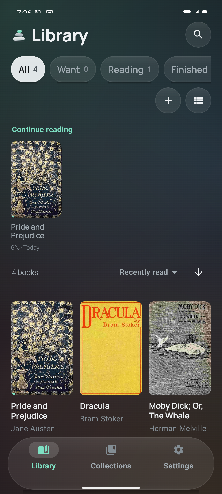

# Kairn

**An offline EPUB reader for Android. Your library, your notes and your place stay on your phone.**

Kairn reads the books you already own. No account, no subscription, nothing to import into: point it at a
folder, or let it find the EPUBs already on your device.

## Why it is built this way

- **Nothing phones home.** No analytics, no crash reporting, no accounts.
- **Your data is files, not a database.** Positions, highlights, notes and settings are plain JSON in the
  app's folder, one file per book.
- **A moved book keeps its history.** Books are identified by their content, so renaming or moving a file
  keeps every highlight and your place in it.
- **A restore cannot leave you worse off.** One zip, validated before anything is touched, with a safety
  copy taken first and a plain statement of what happened.

## Reading

- Page or scroll, with auto scroll at a speed you set per book. It holds still while your finger is on the
  page and picks up when you lift it.
- Read aloud from where you are, and it carries on into the next chapter. Pause and resume land on the word
  you left; speed runs 0.6x to 2.0x per book. It marks the sentence it is speaking, and in page mode the page
  turns to keep up with it. Lock the screen and it keeps reading. A sleep timer stops it after 15, 30 or 45
  minutes, or at the end of the chapter.
- Select a passage to copy it, highlight it, write a note on it, share it as plain text, or look a word up in
  whatever dictionary app you already have. Share and Look up sit in the selection toolbar itself, and either
  can be switched off in Settings.
- Three real typefaces, not CSS keywords: Literata, Manrope and Libron are bundled and served from the app's
  own assets, alongside the publication's own typeface and a monospace fallback. Plus text size, line and
  paragraph spacing, margins, justification, hyphenation and vertical text - per book, with one action to put
  a book back on your defaults and a Reading defaults screen that decides what an untouched book opens with.
- Five page tones from light to true black, plus any custom page and ink pair. Warm light; brightness for this
  app alone or from the system; full screen.
- A whole-book progress slider, and a time left worked out from the book's real word count at your own reading
  speed. Two-page columns on a tablet; contents; footnote pop-ups with a "back to where you were" chip.
- The first open of a book measures its pages once and keeps the result, so later opens skip the walk.
  Settings shows what that and the search index use, and clears both.

## Library

Grid or list; a "Continue reading" shelf with each book's progress and when you were last in it; search over
titles and over the text inside every book, cached after the first pass so a repeat search is instant; sort,
reading status, collections and tags you can rename or delete; several books to one collection or one tag at
once; watched folders; a scan for the EPUBs already on your device; generated covers for books without one;
"Open with" from any file manager.

To add books from a computer on the same Wi-Fi, open the transfer page and drop EPUBs on it from a browser.
The address carries a four-digit code, and nothing else on the network can reach it.

## Notes, highlights, backup

Six highlight colours, notes typed on a selection and edited later, one bookmark per chapter, a per-book list
to jump from, an undo on a deleted highlight, note or bookmark, Markdown export. Kindle highlights come in from the Kindle's own
`My Clippings.txt`, placed by finding each quote in the book. A reading record keeps minutes per day, a streak
and the finished count - in `stats.json`, on the phone. Backup is one zip, optionally with the book files
inside; restore merges or replaces. Point Settings at a folder once and a backup lands there every few days
on its own, keeping the newest few.

## Languages

English, Español, Suomi, 日本語, Tiếng Việt and 简体中文, switched from Settings without leaving the app, with
"System" handing the choice back to the phone. The choice survives a restart.

## Privacy

Kairn makes no outgoing request unless you start the Wi-Fi transfer or leave the update check on. The
transfer server only listens: the computer makes the request, the server lives only while that screen is
open, and it will not answer without the code shown on screen.

The update check is one request a day at most, to `api.github.com`, asking
[github.com/pham-noah/kairn-reader](https://github.com/pham-noah/kairn-reader) for its latest release. It
sends the app name and version as the user agent and nothing else - no install id, no device id, no usage.
It has its own switch in Settings; with it off, the app opens no outgoing connection at all.

`INTERNET` is requested because a socket needs it even to listen. `MANAGE_EXTERNAL_STORAGE` is optional: it
lets the scan see EPUBs already on the device, and the folder picker covers everything else.

## Install

**The signed APK is on the [releases page](https://github.com/pham-noah/kairn-reader/releases).** Every release
is signed with the same dedicated key, so it installs over the one before it and your library, places and
settings survive.

Once installed, Kairn can update itself: Settings > About > "Check for updates" (on by default, once a day)
offers the new APK, downloads it, checks it against the size the release publishes, and hands it to Android's
own installer.

**F-Droid:** not in the main repository yet.

Android 8.0 or newer.

## Build and test

JDK 17+ and the Android SDK; `local.properties` needs `sdk.dir`. The Gradle wrapper is included. The app
builds against SDK 36 (Android 16) with AGP 8.11 and Kotlin 2.1.

    ./gradlew :app:assembleDebug
    ./gradlew :app:testDebugUnitTest          # 195 JVM tests, no device needed
    ./gradlew :app:connectedDebugAndroidTest  # 60 on-device tests, needs a phone or emulator
    ./gradlew :app:lintDebug
    ./gradlew :app:assembleRelease            # signed with the release key when one is present
    python3 tools/check_translations.py       # key parity, format arguments, plural categories

Release assembly needs a keystore (storeFile, storePassword, keyAlias, keyPassword in `keystore.properties`,
outside this repo), pointed at with `KAIRN_KEYSTORE_PROPS`; without one it fails unless `-PallowUnsigned` is
passed, which is what CI and F-Droid build with. That key is not in the repo and must not be lost: only it
can install over an existing install.

[SPEC_STATUS.md](SPEC_STATUS.md) holds the engineering detail: Readium 3.0.0 API traps, the performance work,
and which spec item maps to what.

## What is next

**Translations.** All five are written, and each file was read against the English line by line. A native
reader on Vietnamese would still be worth having. Every user-facing string is a resource and every count is a
plural, so the next language is a `values-xx/strings.xml` away.

**Image zoom inside the page.** Readium has no zoom of its own, so it means scaling the page itself; the part
that has not held up on a device is the hit test for which image you touched.

**Typefaces from your own font files.** Readium serves fonts only from the app's bundled assets, so a font
picked from the device would have to arrive as a base64 `@font-face` injected per resource - possible, and
heavier than it looks.

**F-Droid**, once the project has the history its reviewers ask for.

## Credits and licence

[Readium Kotlin Toolkit](https://github.com/readium/kotlin-toolkit) (BSD-3-Clause) and AndroidX (Apache-2.0).
No proprietary dependencies, no Play Services. Literata and Manrope are embedded copies of the faces Kairn's
own interface uses, both under the SIL Open Font License. Libron is (c) Nico Verbruggen, built on Readerly and
Newsreader, also OFL; its licence and copyright notice ship in the APK at `assets/fonts/`. Apache-2.0 - see
`LICENSE` and `NOTICE`.
